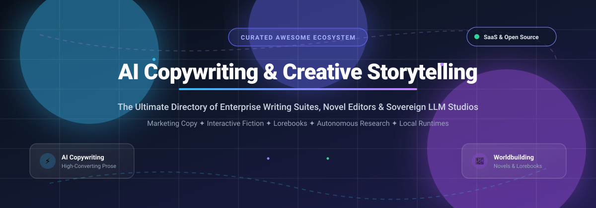
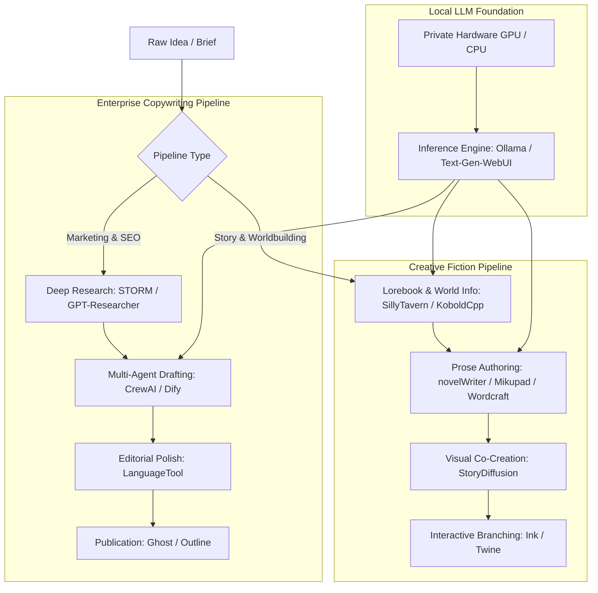

# ✍️ Awesome-AI-Copywriting-Creative-Storytelling

 

 

**Curated ecosystem of SaaS marketing suites, long-form creative fiction studios, lorebooks, multi-agent editorial pipelines, and self-hosted open-source writing engines.**

*Discover the leading tools powering high-converting ad copy, brand voice automation, novel generation, and offline creative worldbuilding.*

---

## 📑 Table of Contents

- [🌐 Sector Overview & Market Dynamics](#-sector-overview--market-dynamics)
- [💼 SaaS & Hosted Writing Platforms](#-saas--hosted-writing-platforms)
- [💻 Open-Source GitHub Projects](#-open-source-github-projects)
- [🛠️ Architectural Blueprints & Workflows](#-architectural-blueprints--workflows)
- [🤝 How to Contribute](#-how-to-contribute)
- [💖 Support](#-support)
- [📈 Star History](#-star-history)
- [⚖️ Disclaimer](#-disclaimer)

---

## 🌐 Sector Overview & Market Dynamics

The global **AI writing assistant and generative copywriting market** is valued at approximately **$3.4 billion** in 2024 and is projected to expand rapidly past **$20 billion to $24 billion by 2033** (achieving a robust CAGR exceeding 25%).

This sector is characterized by **moderate fragmentation transitioning toward enterprise consolidation**:
- While foundational model providers (OpenAI, Anthropic, Google) exert strong gravitational pull, specialized vertical applications—such as enterprise brand-governance suites (Jasper, Copy.ai), SEO topic clusters (Frase, Scalenut), and deep creative fiction environments (Sudowrite, NovelAI)—continue to capture defensible moats.
- Concurrently, a vibrant **sovereign open-source ecosystem** (Ollama, SillyTavern, KoboldCpp, Open WebUI) thrives in parallel, driven by creator demand for uncensored prose, long-context narrative consistency, zero telemetry, and privacy-preserving offline inference.

---

## 💼 SaaS & Hosted Writing Platforms

The table below catalogs premier commercial SaaS solutions for brand copywriting, SEO content automation, and interactive fiction, sorted descending by company scale (valuation / estimated market revenue).

| Rank | SaaS Platform | Scale (Valuation / Revenue) | Starting Price (Paid Tier) | Free Tier / Free Trial Limits | Key Specialization & Core Capabilities |
|:---:|:---|:---|:---|:---|:---|
| 1 | **[Jasper](https://jasper.ai)** | **$1.5B Valuation** (~$55M ARR) | **$69/month** (Pro plan; $59/mo billed annually) | **7-day free trial** with access to core templates and Brand Voice features (card required) | Enterprise marketing copy, style guide enforcement, Brand Voice memory, collaborative content campaigns. |
| 2 | **[Copy.ai](https://copy.ai)** | **~$500M Valuation** (Series C scale) | **$29/month** (Chat tier; $24/mo billed annually) | **7-day free trial** with 1,000 credit allocation; permanent free plan discontinued | AI Go-to-Market (GTM) content automation, automated prospecting sequences, SEO blog builders. |
| 3 | **[Writesonic](https://writesonic.com)** | **~$100M+ Scale** (Backed by YC, institutional) | **$39/month** (Standard plan; $29/mo billed annually) | **Limited free trial** (25 one-time generation credits) for testing Chatsonic and Article Writer | Real-time web-researched SEO generation, Generative Engine Optimization (GEO), and multi-channel marketing copy. |
| 4 | **[Anyword](https://anyword.com)** | **~$80M–$100M Scale** (Backed by Innovation Endeavors) | **$49/month** (Starter tier; $39/mo billed annually) | **7-day free trial** with 2,500 word generation credits | Data-driven predictive performance scoring, audience demographic targeting, conversion-optimized ad copy. |
| 5 | **[Peppertype / Pepper Content](https://contentbot.ai)** | **~$50M Scale** (Backed by Lightspeed India & Battery) | **$35/month** (Starter marketing plan) | **7-day free trial** with 10,000 word generation limit | AI content assistant integrated into enterprise content marketing, SEO briefs, and automated writing workflows. |
| 6 | **[Scalenut](https://scalenut.com)** | **~$25M–$40M Scale** (Venture-backed Series A) | **$39/month** (Essential plan; $23/mo billed annually) | **7-day free trial** with full access to Cruise Mode and 2,000 words | Cruise Mode end-to-end long-form SEO articles, keyword clustering, and real-time NLP content auditing. |
| 7 | **[Frase](https://frase.io)** | **~$15M–$25M Scale** (Acquired by Copy.ai) | **$14.99/month** (Solo plan; 4 articles/mo) | **5-day trial for $1** or limited preview with 1 document audit | SERP content research, AI brief generation, and long-form editorial optimization for search engine rankings. |
| 8 | **[Rytr](https://rytr.me)** | **~$10M–$20M Scale** (Acquired by Copysmith/Contentstack) | **$9/month** (Unlimited plan; $7.50/mo billed annually) | **Free Forever plan** with **10,000 characters/month** and 40+ use cases | Ultra-fast lightweight copywriting, email drafting, social captioning, and multi-language variations across 30+ languages. |
| 9 | **[Sudowrite](https://sudowrite.com)** | **~$10M–$15M Scale** (Indie venture-backed) | **$19/month** (Hobby & Student plan; 225,000 credits/mo) | **Free trial** with **10,000 trial credits** upon signup (no credit card required) | Long-form fiction novel writing, Story Bible worldbuilding, character arc trackers, and chapter expansion. |
| 10 | **[Hypotenuse AI](https://hypotenuse.ai)** | **~$8M–$12M Scale** (~$3M ARR; Y Combinator) | **$19/month** (Individual tier; ~50,000 words/mo) | **7-day free trial** with capped credits to generate product descriptions and blog articles | High-volume e-commerce catalog enrichment, batch SKU copywriting, Shopify/PIM integrations, and SEO content. |
| 11 | **[NovelAI](https://novelai.net)** | **~$5M–$10M Scale** (Profitable bootstrapped SaaS) | **$10/month** (Tablet tier; 1,000 Anlas + 1024 token memory) | **Free trial** with **50 free text generations** and 2,048 memory tokens (no card required) | Privacy-first creative fiction, custom storyteller models (Kayra, Clio), Lorebooks, and AI visual illustration. |
| 12 | **[ContentBot](https://contentbot.ai)** | **~$3M–$6M Scale** (Indie bootstrapped micro-SaaS) | **$19/month** (Prepaid / Starter tier; 50,000 words/mo) | **Limited free trial** with 5,000 one-time words upon registration | Drag-and-drop automated content flows, automated blogging triggers, and multi-step marketing triggers. |

---

## 💻 Open-Source GitHub Projects

Explore the most prominent self-hosted frontends, deep-research engines, narrative worldbuilding tools, and local LLM runtimes. Repositories are ranked descending by GitHub Stars_Count.

| Project & Repo | GitHub_Stars | License | Primary Category | Core Capabilities & Description |
|:---|:---:|:---:|:---:|:---|
| **[Ollama](https://github.com/ollama/ollama)** `ollama/ollama` |  | `MIT` | Local LLM Runtime | The standard developer runtime for running instruction-tuned creative writing and coding models (`Llama 3.3`, `Mistral`, `Gemma 2`, `Qwen 2.5`) locally on macOS, Linux, and Windows. |
| **[Dify](https://github.com/langgenius/dify)** `langgenius/dify` |  | `AGPL-3.0` | Workflow Studio | Self-hostable LLM application development platform ideal for orchestrating custom Brand Voice copywriting pipelines, prompt visual testing, and production content micro-apps. |
| **[Open WebUI](https://github.com/open-webui/open-webui)** `open-webui/open-webui` |  | `BSD-3-Clause` | Writing Studio UI | Feature-complete self-hosted AI workspace with direct Ollama/OpenAI API integration, collaborative Artifacts side-by-side editing, custom system prompt presets, and RAG document grounding. |
| **[CrewAI](https://github.com/crewAIInc/crewAI)** `crewAIInc/crewAI` |  | `MIT` | Multi-Agent Framework | Production framework for orchestrating autonomous AI agent crews—empowering teams to assemble autonomous researcher, copywriter, SEO editor, and proofreader workflows. |
| **[Ghost](https://github.com/TryGhost/Ghost)** `TryGhost/Ghost` |  | `AGPL-3.0` | Publishing Platform | Independent professional publishing platform featuring rich newsletter tools, membership management, and deep extensible integrations with modern AI copywriting pipelines. |
| **[Text Generation WebUI](https://github.com/oobabooga/text-generation-webui)** `oobabooga/text-generation-webui` |  | `AGPL-3.0` | Local Inference UI | Feature-packed Gradio interface for running quantized LLMs (Transformers, ExLlamaV2, GGUF) with notebook modes, parameter tuning, and character roleplay presets. |
| **[LibreChat](https://github.com/danny-avila/LibreChat)** `danny-avila/LibreChat` |  | `MIT` | Multi-Model UI | Open-source enterprise AI chat interface supporting multi-model branching conversations, Artifacts live-code rendering, multimodal inputs, and prompt template libraries. |
| **[Fabric](https://github.com/danielmiessler/fabric)** `danielmiessler/fabric` |  | `MIT` | Prompt CLI Library | Modular CLI and prompt ecosystem providing hundreds of expert-crafted Markdown prompt patterns (`write_essay`, `improve_writing`, `extract_wisdom`, `create_marketing_brief`). |
| **[Outline](https://github.com/outline/outline)** `outline/outline` |  | `BSL-1.1` | Team Knowledge Base | Fast, collaborative team knowledge base and documentation workspace with markdown editing, enterprise permission models, and AI drafting extensions. |
| **[Khoj](https://github.com/khoj-ai/khoj)** `khoj-ai/khoj` |  | `AGPL-3.0` | Personal AI & RAG | Self-hostable AI desktop assistant that indexes personal Markdown notes, PDFs, GitHub repositories, and Notion docs to ground long-form writing in your personal knowledge base. |
| **[SillyTavern](https://github.com/SillyTavern/SillyTavern)** `SillyTavern/SillyTavern` |  | `AGPL-3.0` | Narrative & Roleplay UI | Powerhouse local-first frontend for creative storytelling, multi-character interactions, rich World Info lorebooks, author notes, and customizable narrative branching. |
| **[STORM](https://github.com/stanford-oval/storm)** `stanford-oval/storm` |  | `MIT` | Autonomous Synthesis | Stanford University's AI system that autonomously explores web topics from multiple perspectives, interviews simulated domain experts, and writes cited, Wikipedia-style synthesis drafts. |
| **[GPT-Researcher](https://github.com/assafelovic/gpt-researcher)** `assafelovic/gpt-researcher` |  | `Apache-2.0` | Deep Research Agent | Autonomous research agent that browses 20+ web sources concurrently to generate comprehensive, fact-checked, long-form editorial drafts with citations. |
| **[LanguageTool](https://github.com/languagetool-org/languagetool)** `languagetool-org/languagetool` |  | `LGPL-2.1` | Editorial Proofreader | Open-source multilingual style, grammar, and tone-checking engine used to proofread and polish AI copywriting drafts across 30+ spoken languages locally. |
| **[KoboldCpp](https://github.com/LostRuins/koboldcpp)** `LostRuins/koboldcpp` |  | `AGPL-3.0` | Creative LLM Engine | Single-file zero-dependency local LLM server bundled with **KoboldAI Lite**—a dedicated creative fiction writing studio equipped with World Info lorebooks, memory slots, and author notes. |
| **[StoryDiffusion](https://github.com/HVision-NKU/StoryDiffusion)** `HVision-NKU/StoryDiffusion` |  | `Apache-2.0` | Visual Story Engine | Visual narrative framework that generates consistent characters and sequential multi-frame comic layouts to accompany AI-written stories and scripts. |
| **[Ink](https://github.com/inkle/ink)** `inkle/ink` |  | `MIT` | Interactive Scripting | Inkle's industry-standard narrative scripting language for interactive fiction and video games, frequently integrated with LLMs for branching dialogue and narrative generation. |
| **[novelWriter](https://github.com/vkbo/novelWriter)** `vkbo/novelWriter` |  | `GPL-3.0` | Markdown Novel Studio | Dedicated plain-text markdown editor designed specifically for authoring large multi-chapter novels, featuring character/location cross-referencing, word count tracking, and manuscript exports. |
| **[Twine](https://github.com/klembot/twinejs)** `klembot/twinejs` |  | `GPL-3.0` | Nonlinear Fiction | Open-source visual tool for authoring interactive, branching stories and narrative game web apps without deep programming knowledge. |
| **[RisuAI](https://github.com/kwaroran/RisuAI)** `kwaroran/RisuAI` |  | `AGPL-3.0` | Web Narrative Client | Advanced web/electron frontend for roleplay storytelling and interactive fiction, featuring regex text formatters, character asset packs, and prompt scripting. |
| **[AgnAI](https://github.com/agnaistic/agnai)** `agnaistic/agnai` |  | `AGPL-3.0` | Multi-User Storytelling | Open-source multiplayer interactive storytelling platform supporting local backends and commercial APIs with rich character lore and memory persistence. |
| **[Mikupad](https://github.com/lmg-anon/mikupad)** `lmg-anon/mikupad` |  | `MIT` | Minimalist Prose Notebook | Single-HTML-file distraction-free creative writing scratchpad for local LLMs, offering interactive logit probability inspection and inline sentence completions. |
| **[Wordcraft](https://github.com/PAIR-code/wordcraft)** `PAIR-code/wordcraft` |  | `Apache-2.0` | Human-AI Co-Writing | Research prototype from Google People + AI Research (PAIR) designed for co-creative story writing with targeted editing prompts, sensory expansions, and narrative controls. |

---

## 🛠️ Architectural Blueprints & Workflows

Build custom enterprise writing or fiction pipelines by combining modular open-source layers:

---

## 🤝 How to Contribute

We welcome additions, fixes, and ecosystem updates from authors, marketers, and open-source contributors!

1. 🍴 **Fork the repository**.
2. 🌿 **Create a descriptive branch** (`git checkout -b add-my-writing-tool`).
3. 📝 **Add your entry** to the appropriate table or section following the established format:
   - For SaaS tools: include verified starting tier pricing and specific free trial / free tier terms.
   - For Open-Source tools: include GitHub repository link, license, category, and Stars_Badge.
4. 🚀 **Submit a Pull Request** explaining what the tool does and why it benefits the creative writing and copywriting ecosystem.

---

## 💖 Support

If this curated directory has helped you discover powerful copywriting suites, streamline your content pipeline, or build private creative storytelling studios, please consider supporting the project:

- ⭐ **Star this repository** on GitHub to boost its visibility for fellow writers and developers.
- 🍴 **Fork and share** with your narrative design, marketing, and developer networks.
- ☕ **Buy a coffee & sponsor ongoing research** via the [GitHub Sponsors Dashboard](https://github.com/sponsors/ishandutta2007).

Your sponsorship helps maintain active data updates, benchmark local LLM writing presets, and keep this directory independently curated!

---

## 📈 Star History

---

## ⚖️ Disclaimer

- This is a community-curated, independent directory provided for educational, informational, and research purposes. Product names and trademarks belong to their respective owners.
- AI-generated copy and creative manuscripts may occasionally include hallucinations, unverified factual claims, or stylistic biases. Always incorporate human editorial review, brand guideline checks, and fact-checking before publishing.
